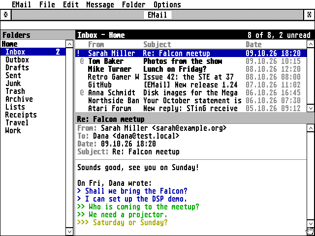
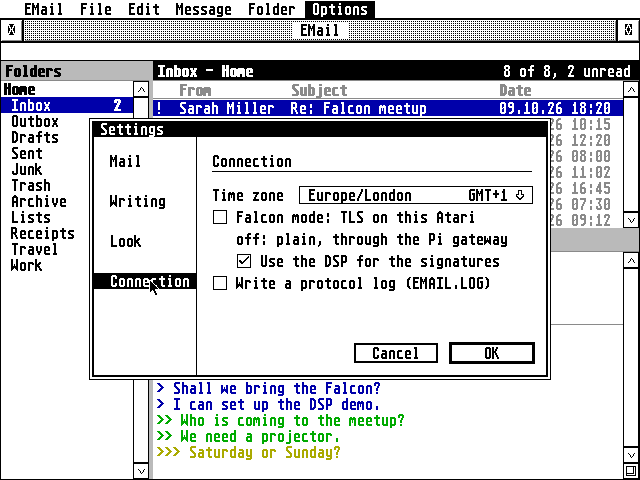

# EMail


An e-mail program for the Atari ST, STE, TT and Falcon, written in C for
GEM.



**Highlights**

- **IMAP and POP3 in, SMTP out**, with an Outbox for sending later and
  copies in Sent
- **Two ways to reach today's providers:** a Raspberry Pi gateway for any
  Atari, or **Falcon mode** with TLS 1.2 on the Atari itself and RSA on
  the Falcon's DSP
- **Hebrew throughout:** UTF-8, ISO-8859-8 and windows-1255 mail,
  right-to-left layout, the Israeli keyboard on F10, Hebrew in vector
  fonts through NVDI
- **Works offline:** a mirror of your folders and the messages you've
  read on disk; read, flag and move offline, the server catches up later
- **Fast checks:** the Inbox is fetched and every other folder's counts
  are asked for in one go, so new mail filed in Junk or by server rules
  shows up too
- **Bulk operations:** select several messages and mark read or unread,
  flag, move or delete them together
- **Folders:** create, rename and delete; an alphabetical folder picker
  for moving messages
- **Modern but Atari:** one window with draggable panes, right-click
  menus, colour on 16- and 256-colour screens, a Settings dialog with a
  sidebar, progress on the status line
- **Runs in TT RAM** when the machine has some
- **Your time zone by name** (Asia/Jerusalem, Europe/London...), with
  summer time worked out by itself and found from the machine when it
  says
- **Passwords encrypted** in EMAIL.INF, hidden behind an eye button in
  the dialogs
- Runs on TOS 1.04 to 4.x, EmuTOS, MagiC and MiNT, with STinG or MiNTnet,
  from a 68000 ST in medium resolution to a Falcon in 640×480

**In more detail**

- IMAP with a local mirror: headers of the newest messages and every
  message you've read, kept in step with the server; big folders load
  100 messages at a time, with "Load more" for older ones. Read and flag
  changes are sent in one go when you pause, and at the latest on quit
- POP3 that downloads into local folders and never fetches a message twice
- SMTP with login (AUTH PLAIN/LOGIN)
- Reply, reply to all, forward (with the original's attachments), flags,
  move, delete to Trash, mark a whole folder read, address book, a
  two-line signature
- Attachments: save them with the file selector; attach files when writing
- HTML-only mail shown as text
- Dates with the year, numbers with thousands separators
- Fonts: the system font in two sizes and any monospaced GDOS font
  (bitmap, Speedo, TrueType); the selector lists only the fonts EMail can
  use. A vector font's Hebrew letters are found through NVDI 5 by
  Unicode (FreeMono and Liberation Mono have them); a font without them
  gets its Hebrew drawn in the system font
- Separate server settings for the gateway and for Falcon mode, so
  switching between them keeps both
- EMAIL.INF in capitals, each setting with a note above it



Mail providers want encrypted connections. EMail reaches them one of two
ways, switched with Options > Falcon mode:

```
off (default):  Atari (EMAIL.PRG) --STinG/MiNTnet--> Raspberry Pi (emailgate) --TLS--> provider
on:             Falcon (EMAIL.PRG, TLS 1.2, RSA on the DSP) --STinG/MiNTnet--TLS--> provider
```

- **Off**, on any Atari: a Raspberry Pi on your network does the
  encryption, see [gateway/README.md](gateway/README.md). A server that
  accepts plain connections can be used directly.
- **On**, on a Falcon or TT with 4 MB or more (TT RAM helps): EMail does TLS 1.2 itself
  with [BearSSL](https://bearssl.org/) (common/third_party/bearssl), built for
  the 68030, and the Falcon's DSP56001 checks the servers' RSA
  signatures. It needs `CACERT.PEM` and `ROOTS.DAT` (in `binary/`)
  next to EMAIL.PRG. See [Falcon mode](docs/GUIDE.md#falcon-mode).

EMail follows the design of Troll, the GFA-BASIC newsreader and mail
client by Rajah Lone: the same four windows (folders, message list,
message, editor), IMAP mirroring, and STinG or MiNTnet networking. It
reuses parts of Claude ST
([whomper/atari_claude](https://github.com/whomper/atari_claude)): the
freestanding TOS runtime, GEM bindings, STinG client, Hebrew
right-to-left layout and keyboard, and the Hatari test tools.

## Performance: Pi, 68030 and DSP

What costs time is the TLS handshake, once per connection: EMail keeps
its IMAP connection open, so that is once per session, plus once for
each batch of mail sent.

| | Pi gateway | Falcon mode, 68030 only | Falcon mode, 68030 + DSP |
|---|---|---|---|
| Machines | any Atari, 68000 ST too | Falcon, TT (68030) | Falcon |
| Handshake, stock 16 MHz Falcon | done by the Pi, a fraction of a second | about 9.6 s | about 2.5 s |
| Handshake, 50 MHz Falcon in TT/fast RAM | done by the Pi | about 5 s | about 1.5 s |
| Reading mail once connected | as fast as STinG/MiNTnet carry it | 39 KB/s (16 MHz), 66 KB/s (50 MHz, fast RAM) | the same: the DSP only helps the handshake |
| Work on the Atari | none, plain IMAP/SMTP | all of TLS | TLS, RSA checks on the DSP |

In a handshake the 68030 does the key exchange (X25519, 0.5 to 1 s each,
two of them) and the DSP56001 the three RSA-2048 certificate checks
(about 0.12 s each instead of 1.3 to 2.5 s). Running from TT/fast RAM
matters as much as the clock: ST RAM is 16 bits wide and shared with the
video, so EMail loads itself into TT RAM when there is some (the About
box says where it runs). A 68000 ST has no chance of TLS in reasonable
time and always goes through the Pi.

The 50 MHz figures were measured on a real Falcon with a DFB1X board,
the 16 MHz ones in cycle-exact emulation; details in
[tools/tlsbench](tools/tlsbench/README.md).

## Getting started

Everything to copy to the Atari is in [`binary/`](binary): `EMAIL.PRG`,
`CACERT.PEM` and `ROOTS.DAT` (Falcon mode), `EMAIL.HYP` (the user guide for
ST-Guide, opened by the Help key), and the desktop icon in `binary/icons/`.

1. Copy `EMAIL.PRG` into a folder of its own on your Atari, e.g. `C:\EMAIL\`.
2. Set up the gateway on a Raspberry Pi: `sudo gateway/install.sh
   imap.gmail.com smtp.gmail.com` (see [gateway/README.md](gateway/README.md)).
3. Start EMail and fill in your account: the Pi's IP address, ports 143
   (IMAP) and 587 (SMTP), your login.

Or, on a Falcon or TT with 4 MB: copy `EMAIL.PRG`, `CACERT.PEM` and
`ROOTS.DAT` into the folder, skip the Pi, and switch on Options > Falcon
mode; EMail fills in the servers for the big providers.

The [user guide](docs/GUIDE.md) describes everything else.

## Building

```
sudo apt install gcc-m68k-linux-gnu      # Debian/Ubuntu
make                                     # writes binary/EMAIL.PRG and binary/ROOTS.DAT
```

Every build of EMAIL.PRG gets the next version: the Makefile counts up the
minor number in `VERSION` (major.minor, e.g. 1.6) each time it links the
program; it shows in the About box and the User-Agent header. Commit
`VERSION` together with the program.

The ST-Guide help file `binary/EMAIL.HYP` is made from `docs/GUIDE.md`
by `tools/mkhelp.py` and the HCP compiler from the
[hypview](https://github.com/th-otto/hypview) project:
`make help HCP=/path/to/hcp`.

No MiNTLib is needed: the program is freestanding (`atari/`) and
`common/tools/elf2tos.py` writes the TOS executable. It is built for the 68000,
so it runs on every Atari from the ST to the Falcon; only BearSSL, used in
Falcon mode, is 68030 code. ROOTS.DAT is CACERT.PEM decoded on the build
computer by `common/tools/mkroots.c`, so the Atari doesn't have to.
The DSP program is `common/dsp/rsa.a56`; `common/dsp/mkh.py` assembles it into
`common/dsp/rsa_prog.h` (with the `a56` assembler: `cd common/dsp && a56 rsa.a56 && python3 mkh.py a56.out rsa_prog.h dsp_rsa_prog`).

## Source

```
atari/   TOS runtime: start-up, system calls, a small C library, AES/VDI,
         TCP over STinG/STiK or MiNTnet (with a DNS client)
src/     the mail core: IMAP, POP3, SMTP, MIME, charsets and Hebrew,
         bidi, the local store, composing, mail operations, TLS (tls.c)
common/  code shared with the other AERA programs (from AERA-Atari):
         BearSSL, the DSP RSA program, bidi, dates, passwords, build tools
ui/      the GEM program: windows, drawing, editor, dialogs, menus
gateway/ the Raspberry Pi gateway (emailgate.py, install.sh)
tests/   unit and integration tests, the Hatari test rig
tools/   the icon generator, sync-common.sh, FAKESTNG.PRG (for testing in Hatari only)
binary/  what goes on the Atari: EMAIL.PRG, CACERT.PEM, ROOTS.DAT, EMAIL.HYP,
         and the desktop icon (icons/, RSC and ICN files)
```

## Tests

The mail core (`src/`) also builds on Linux, where it is tested against
real servers before it runs on the Atari:

```
make test           # charsets (Hebrew), MIME, message building, bidi
make itest          # IMAP, POP3, SMTP against a local Dovecot and a test SMTP server
TLS=1 make itest    # the same through the gateway (emailgate.py), TLS-only servers
FALCON=1 make itest # Falcon mode: EMail's own TLS, implicit TLS and STARTTLS
```

`make itest` needs `dovecot-imapd` and `dovecot-pop3d`; `TLS=1` also
needs `openssl`. `make test` also runs the gateway's own tests, and the
fuzz targets' inputs again (`tests/fuzz`; `make fuzz` with clang fuzzes
the IMAP, POP3, SMTP and MIME readers).

`tests/hatari/` runs EMAIL.PRG itself in the
[Hatari](https://hatari.tuxfamily.org/) emulator with
[EmuTOS](https://emutos.sourceforge.io/), with Xvfb and xdotool:

```
make -C tools/fakesting
tests/hatari/net_test.py /tmp/mail-net etos512us.img   # Falcon, real servers
tests/hatari/ui_tour.py WORKDIR etos512us.img          # screenshots of the interface
tests/hatari/screenshots.py WORKDIR etos512us.img      # the pictures in docs/, English sample mail
tests/hatari/falcon_test.py /tmp/mail-tls etos512us.img --dsp emu   # Falcon mode, TLS + DSP
```

`net_test.py` boots an emulated Falcon, where EMail logs in to Dovecot,
mirrors the inbox, opens a Hebrew message and sends a Hebrew reply; the
test checks the reply and its copy in Sent on the server. Hatari has no
network card, so `FAKESTNG.PRG` stands in for STinG and carries EMail's
connections over the emulated serial port to `serial_bridge.py`. It's
for the emulator only; never install it on a real Atari.

## Licence

EMail is free software: you can redistribute it and/or modify it under
the terms of the GNU General Public License as published by the Free
Software Foundation, either version 2 of the License, or (at your option)
any later version. It is distributed in the hope that it will be useful,
but WITHOUT ANY WARRANTY; without even the implied warranty of
MERCHANTABILITY or FITNESS FOR A PARTICULAR PURPOSE. See [COPYING](COPYING).

Copyright (C) 2026 Erez Yaary.

It includes, under their own licences (compatible with the GPL):

- [BearSSL](common/third_party/bearssl) by Thomas Pornin: MIT licence
  ([LICENSE.txt](common/third_party/bearssl/LICENSE.txt))
- `CACERT.PEM`, the root certificates for Falcon mode, from Mozilla's CA
  list (Mozilla Public License 2.0)
